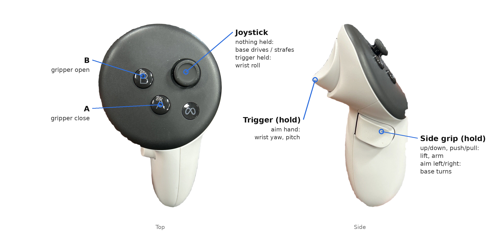
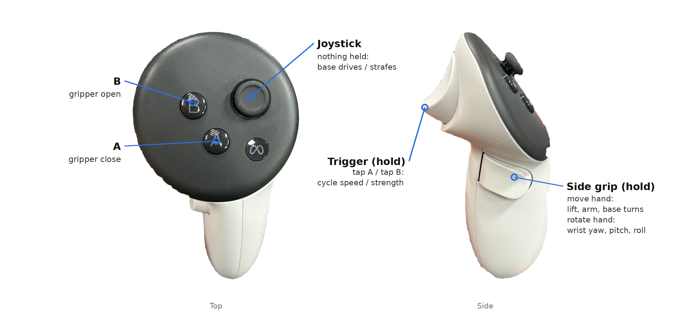

# Teleoperating Stretch4 using Meta Quest

Drive a Stretch 4 with the right-hand Meta Quest controller. There are two scripts:

- [`stretch_quest_teleop.py`](#quest-teleop-speed-control): your hand's offset sets
  joint *speeds*, like a joystick.
- [`stretch_quest_dex_teleop.py`](#quest-dex-teleop): the gripper follows your hand
  1:1, using Dex Teleop's control scheme.

Both need the [Install](#install) steps and use the headset the same way. After
that, follow the section for the script you want.

## Contents

- [Install](#install)
- [Using the headset](#using-the-headset)
  - [Waiting for the controller times out](#waiting-for-the-controller-times-out)
- [Quest Teleop (speed control)](#quest-teleop-speed-control)
  - [Run](#run)
  - [Controls](#controls)
- [Quest Dex Teleop](#quest-dex-teleop)
  - [Setup](#setup)
  - [Run](#run-1)
  - [Controls](#controls-1)
  - [How the Dex Teleop submodule is used](#how-the-dex-teleop-submodule-is-used)
- [Troubleshooting](#troubleshooting)
  - [Switching from the jborbik app](#switching-from-the-jborbik-app)

## Install

1. **This repo.**

   ```bash
   git clone https://github.com/hello-robot/stretch4_quest_teleop.git
   cd stretch4_quest_teleop
   pip install numpy
   ```

2. **oculus_reader.** This is the library that reads the Quest controller. On the
   robot, follow the setup steps in the
   [oculus_reader README](https://github.com/hello-shaumik/oculus_reader#readme).
   We use [our fork](https://github.com/hello-shaumik/oculus_reader)
   of [jborbik/oculus_reader](https://github.com/jborbik/oculus_reader): same Python
   library, but its headset app shows the room (passthrough) instead of a test scene.

   **Careful:** the oculus_reader README tells you to clone the repository but
   doesn't show the command, and it never tells you to install the Python package.
   When you reach its
   ["Clone the repository"](https://github.com/hello-shaumik/oculus_reader#clone-the-repository)
   section, first install Git LFS as that section says, then run these commands:

   ```bash
   cd ~/repos
   git clone https://github.com/hello-shaumik/oculus_reader.git
   cd oculus_reader
   python3 -m pip install --user -e .
   ```

   Already have jborbik's oculus_reader? See
   [Switching from the jborbik app](#switching-from-the-jborbik-app).

   Then go back and continue with the rest of the oculus_reader README.

   We tested with commit
   [`efdcb71`](https://github.com/hello-shaumik/oculus_reader/commit/efdcb71).
   If a newer version gives you trouble, `git checkout efdcb71` and try again.

3. **Robot.** Home it with `stretch_robot_home`. Only one program can control the
   robot at a time, so close anything else that sends it commands: `stretch_driver`,
   gamepad teleop, or another teleop script.

## Using the headset

This applies to both scripts.

When a script starts, it opens the headset app, and the headset shows **the room
around you** (passthrough), with no menus or panels. That means the app is running
and sending controller poses. If you see the Meta home screen or a dialog instead,
the app isn't in front and the robot won't get anything; see
[Waiting for the controller](#waiting-for-the-controller-times-out).

Hand motions are measured in the **headset's** frame: "push forward" means forward
from where the headset is facing, not from where the robot is facing. So:

- Wear the headset **over your eyes**. You see the robot through the headset's
  cameras.
- Stand **behind or beside the robot, facing the same way as its arm**, so your
  forward, left and up match the robot's.
- Keep your **head roughly level** and facing the way the arm points while you
  drive. If you look down, "straight up" with your hand also pushes the arm out a
  little.

### Waiting for the controller times out

The script keeps waiting and prints what's wrong and how to fix it. The usual causes:

- **Headset asleep.** Put it on, or press the power button.
- **App not in front.** You should see the room with no menus. Close any dialog,
  and don't press the Meta button.
- **Controllers asleep.** Press a button on both.

## Quest Teleop (speed control)

`stretch_quest_teleop.py`: your hand's offset sets joint *speeds*, like a joystick.
Do the [Install](#install) steps first.

### Run

```bash
cd ~/repos/stretch4_quest_teleop/
python3 stretch_quest_teleop.py
```

Add `--dry-run` to test the mappings without moving the robot.

### Controls

Hold a button, then move your hand. The further from where you started, the faster
the joint moves. Wrist roll is on the joystick, so twisting your hand never moves the
wrist.



| Hold | Then | Robot |
|---|---|---|
| Side grip | move hand up/down, push/pull | lift, arm |
| Side grip | aim hand left/right | base turns |
| Trigger | aim hand left/right, up/down | wrist yaw, pitch |
| Trigger | joystick left/right | wrist roll |
| Nothing | joystick | base drives / strafes |
| — | A / B | gripper close / open |

Release everything to stop.

## Quest Dex Teleop

`stretch_quest_dex_teleop.py` uses
[Dex Teleop](https://github.com/hello-robot/stretch4_dex_teleop)'s control scheme:
**hold the side grip and the gripper follows your hand 1:1** (position
control, not speed). Moving your hand moves the lift, arm and base; rotating your
hand moves the wrist. Release the grip and re-grip to reach further.

### Setup

Do the [Install](#install) steps above first (oculus_reader, homed robot, nothing
else controlling it). Then:

1. **Get the Dex Teleop submodule.** A plain `git clone` leaves
   `third_party/stretch4_dex_teleop/` empty.

   ```bash
   # new clone
   git clone --recurse-submodules https://github.com/hello-robot/stretch4_quest_teleop.git

   # existing clone (also run this after every `git pull`; pull doesn't update submodules)
   cd ~/repos/stretch4_quest_teleop
   git submodule update --init
   ```

   If you skip this, the script stops with
   `stretch4_dex_teleop not found ... Run: git submodule update --init`.

   We tested with Dex Teleop commit
   [`643160c`](https://github.com/hello-robot/stretch4_dex_teleop/commit/643160c)
   (2026-11-12). That's the commit this repo pins, so `git submodule update
   --init` gets you exactly that version.

2. **Python packages** for the IK. Check first; the
   robot may already have all of them:

   ```bash
   python3 -c "import numpy, scipy, urchin, numba; print('all present')"
   ```

   If it prints `all present`, skip to step 3. Otherwise install them into a
   virtual environment, so the robot's own Python isn't changed:

   ```bash
   cd ~/repos/stretch4_quest_teleop
   python3 -m venv --system-site-packages .venv
   source .venv/bin/activate
   pip install numpy scipy urchin numba
   pip install -e ~/repos/oculus_reader
   python3 -c "import stretch4_body, oculus_reader; print('ok')"   # must print ok
   ```

   - `--system-site-packages` is required: `stretch4_body` comes with the robot
     and isn't on PyPI, so the venv has to see the robot's Python.
   - oculus_reader is installed again because a venv doesn't see packages
     installed with `pip install --user`, which is how [Install](#install)
     installs it.
   - Run `source .venv/bin/activate` in each new terminal before running the
     script.

   You don't need Dex Teleop's full `requirements.txt` (OpenCV, webcam
   packages); this script doesn't use its webcam front end.

3. **Check it** before letting it move anything:

   ```bash
   python3 stretch_quest_dex_teleop.py --dry-run     # headset only; the robot is never touched
   python3 stretch_quest_dex_teleop.py --self-test   # robot only; MOVES THE ARM to Dex Teleop's start pose
   ```

### Run

```bash
cd ~/repos/stretch4_quest_teleop/
source .venv/bin/activate     # only if you made the venv in Setup step 2
python3 stretch_quest_dex_teleop.py
```

The robot doesn't move at startup; it starts from wherever the arm already is. Add
`-d` to drive the robot directly instead of through the body server.

### Controls

Hold the side grip and the gripper follows your hand. Release it to stop, move your
hand back, and grip again to reach further. Past a joint limit (lift top/bottom,
arm in/out, a wrist joint) the gripper stops at the limit, and moving back responds
straight away. Releasing and re-gripping also resets how the controller lines up
with the gripper, so do that if twisting or tilting ever feels off.



| Hold | Then | Robot |
|---|---|---|
| Side grip | move hand | gripper position follows (lift, arm, base turns to reach sideways) |
| Side grip | rotate hand | wrist yaw, pitch, roll follow |
| Nothing | joystick | base drives / strafes |
| — | A / B | gripper close / open |
| Trigger | tap A / tap B | cycle speed / strength |

Wear and hold the headset as in [Using the headset](#using-the-headset).

### How the Dex Teleop submodule is used

Dex Teleop isn't copied into this repo. It's a
[git submodule](https://git-scm.com/book/en/v2/Git-Tools-Submodules) at
`third_party/stretch4_dex_teleop/`, pinned to one commit of
`hello-robot/stretch4_dex_teleop`. This repo records only which commit; the
files come from that repo.

- **What comes from Dex Teleop:** everything that moves the arm, wrist and base
  rotation: the IK (`simple_ik.py` and its URDFs), smoothing, wrist decoding,
  joint limits and base rotation (`gripper_to_goal.py`, `robot_move.py`), and
  their tuning (`dex_teleop_parameters.py`).
- **What's in this repo:** the Quest front end in `quest_teleop/`:
  - `dex_bridge.py`: the only file that imports the submodule. It refuses to
    run if a Dex Teleop module was loaded from anywhere else.
  - `dex_frontend.py`: clutch, frame mapping, goal, settings chords.
  - `dex_wrist.py`: a copy of Dex Teleop's wrist-angle maths, used to clamp
    the wrist at its limits and for the HUD and grip anchor (see its header for
    why it's copied).
  - `dex_hud.py`: the terminal dashboard.
- **Which commit is pinned:** `git submodule status`.
- **Move the pin to a newer Dex Teleop:**

  ```bash
  cd third_party/stretch4_dex_teleop
  git fetch origin && git checkout <commit>      # e.g. origin/main
  cd ../..
  git add third_party/stretch4_dex_teleop
  git commit -m "Bump stretch4_dex_teleop to <commit>"
  ```

  Then rerun `--dry-run` and `--self-test`. If Dex Teleop changed its wrist
  decoding in `update_goal()`, update `quest_teleop/dex_wrist.py` to match.

## Troubleshooting

| Problem | Fix |
|---|---|
| `APK install failed` | Run `git lfs pull` in the oculus_reader folder, then `adb uninstall com.rail.oculus.teleop` and try again |
| `INSTALL_FAILED_UPDATE_INCOMPATIBLE` / `signatures do not match` | The headset has the jborbik app; see [Switching from the jborbik app](#switching-from-the-jborbik-app) |
| `could not reach the headset over ADB` | Check `adb devices`; accept the prompt in the headset |
| `adb devices` shows nothing | Try another USB-C cable (it must carry data) and check Developer Mode is on |
| `'r' key is missing` | Wake both controllers |
| Lease conflict on start | Another program is controlling the robot through the server; close it |

Run any script with `--help` to see all options. Ctrl-C stops the robot and exits.

### Switching from the jborbik app

If your oculus_reader clone, or the app on the headset, came from
jborbik/oculus_reader, switch both to our fork. The jborbik app is signed with a
different key, so it has to be uninstalled first:

```bash
cd ~/repos/oculus_reader
git remote add shaumik https://github.com/hello-shaumik/oculus_reader.git
git fetch shaumik && git checkout -B main shaumik/main
git lfs pull
adb uninstall com.rail.oculus.teleop
python3 oculus_reader/install.py
```
