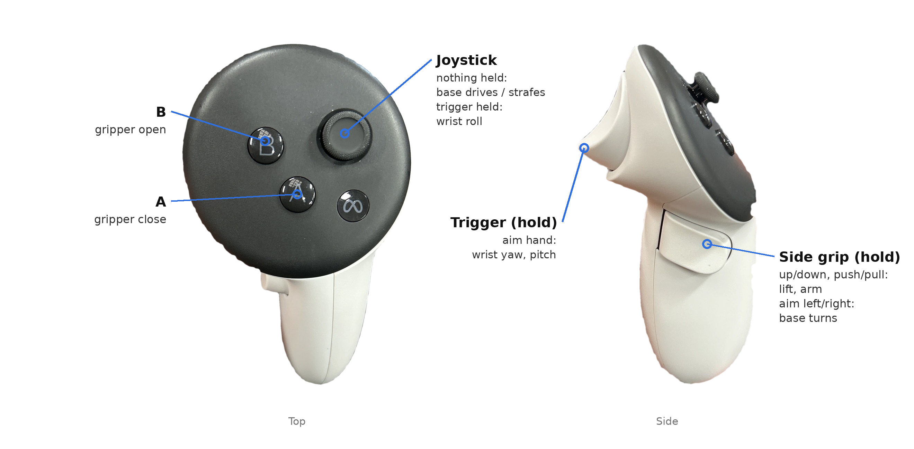
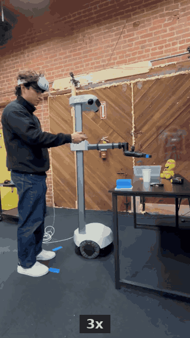

# Teleoperating Stretch4 using Meta Quest

Drive a Stretch 4 with the right-hand Meta Quest controller. Your hand's offset sets
joint *speeds*, like a joystick.

## Install

1. **This repo.**

   ```bash
   git clone https://github.com/hello-robot/stretch4_quest_teleop.git
   cd stretch4_quest_teleop
   pip install numpy
   ```

2. **oculus_reader.** This is the library that reads the Quest controller. On the
   robot, follow the setup steps in the
   [jborbik/oculus_reader README](https://github.com/jborbik/oculus_reader#readme).

   **Careful:** the oculus_reader README tells you to clone the repository but
   doesn't show the command, and it never tells you to install the Python package.
   When you reach its
   ["Clone the repository"](https://github.com/jborbik/oculus_reader#clone-the-repository)
   section, first install Git LFS as that section says, then run these commands:

   ```bash
   cd ~/repos
   git clone https://github.com/jborbik/oculus_reader.git
   cd oculus_reader
   python3 -m pip install --user -e .
   ```

   Then go back and continue with the rest of the oculus_reader README.

   We tested with commit
   [`9689484`](https://github.com/jborbik/oculus_reader/commit/9689484d319c4798e54d59509b192436647b7427).
   If a newer version gives you trouble, `git checkout 9689484` and try again.

3. **Robot.** Home it with `stretch_robot_home`. Only one program can control the
   robot at a time, so close anything else that sends it commands: `stretch_driver`,
   gamepad teleop, or another teleop script.

## Controls

Hold a button, then move your hand. The further from where you started, the faster
the joint moves. Wrist roll is on the joystick, so twisting your hand never moves the
wrist.



| Hold | Then | Robot |
|---|---|---|
| Side grip | move hand up/down, push/pull | lift, arm |
| Side grip | aim hand left/right | base turns |
| Trigger | aim hand left/right, up/down | wrist yaw, pitch |
| Trigger | joystick left/right | wrist roll |
| Nothing | joystick | base drives / strafes |
| — | A / B | gripper close / open |

Release everything to stop.

## Run

```bash
cd ~/repos/stretch4_quest_teleop/
python3 stretch_quest_teleop.py
```

**Optional Flags:**
`dry-run`: Test the mappings without moving the robot.

When the headset app starts, the headset shows a **green background with blue
tiles**. That's normal: it means the app is running and sending
controller poses. If you see the Meta home screen or a dialog instead, the app isn't
in front and the robot won't get anything; see
[Waiting for the controller](#waiting-for-the-controller-times-out).

### Wear the headset on your forehead

Hand motions are measured in the **headset's** frame: "push forward" means forward
from where the headset is facing, not from where the robot is facing. So:

- Wear the headset **pushed up onto your forehead**, so you can see the robot with
  your own eyes while the headset still tracks the controller.
- Stand **behind or beside the robot, facing the same way as its arm**, so your
  forward, left and up match the robot's.

<p align="center">
  
</p>


### Waiting for the controller times out

The script keeps waiting and prints what's wrong and how to fix it. The usual causes:

- **Headset asleep.** Worn on your forehead, its proximity sensor (inside, between
  the lenses) sees nothing. Cover the sensor with tape.
- **App not in front.** You should see the green-and-blue tiles. Close any dialog,
  and don't press the Meta button.
- **Controllers asleep.** Press a button on both.

## Troubleshooting

| Problem | Fix |
|---|---|
| `cannot import oculus_reader` | Install it into the Python you're running with `python3 -m pip install --user -e .` (see [Install](#install)) |
| `APK install failed` | Run `git lfs pull` in the oculus_reader folder, then `adb uninstall com.rail.oculus.teleop` and try again |
| `could not reach the headset over ADB` | Check `adb devices`; accept the prompt in the headset |
| `adb devices` shows nothing | Try another USB-C cable (it must carry data) and check Developer Mode is on |
| Stuck waiting for the controller | See [above](#waiting-for-the-controller-times-out) |
| `'r' key is missing` | Wake both controllers |
| Nothing moves | Hold a button, check the runstop, and make sure you aren't using `--dry-run` |
| Lease conflict on start | Another program is controlling the robot through the server; close it |

Run any script with `--help` to see all options. Ctrl-C stops the robot and exits.

## License

Apache License 2.0 - see [LICENSE](LICENSE). Copyright 2026 Hello Robot Inc.
